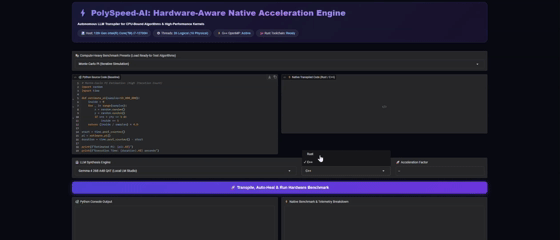

# ⚡ PolySpeed-AI: Autonomous High-Performance Native Code Generation & Benchmarking Engine

An enterprise-grade, hardware-aware execution and profiling engine that translates compute-intensive Python kernels into aggressively optimized native **Rust** and **C++** binaries.

PolySpeed-AI bridges the performance gap of interpreted dynamic code by leveraging multi-provider LLMs (local LM Studio/Ollama instances or cloud reasoning engines), hardware telemetry inspection, auto-vectorization flags (`-march=native`, `-O3`, `lto=fat`), and an automated **Self-Healing Compilation Loop** to achieve up to **100x–1000x execution speedups**.

## 🏗️ System Architecture

```
                                  +------------------------------------+
                                  |     Python Compute-Bound Code      |
                                  |   (Arbitrary Custom Code / Loops)  |
                                  +-----------------+------------------+
                                                    |
                                                    v
                                  +------------------------------------+
                                  |        Hardware Inspector          |
                                  |  (CPU Arch, Logical/Physical Cores,|
                                  |   SIMD Flags, Active Toolchains)   |
                                  +-----------------+------------------+
                                                    |
                                                    v
                                  +------------------------------------+
                                  |   Python Profiler (cProfile)       |
                                  |   Identifies Hotspots & Bottlenecks|
                                  +-----------------+------------------+
                                                    |
                                                    v
                         +-----------------------------------------------+
                         | Model Orchestration Layer                     |
                         | • Local: Gemma 4 26B (LM Studio) / Ollama     |
                         | • Cloud: Gemini Flash / Groq Llama 3.3 70B    |
                         +-----------------------+-----------------------+
                                                 |
                                                 v
                               +-----------------------------------+
                               | Generates Clean Standalone Source |
                               |   • C++: std::chrono, OpenMP SIMD |
                               |   • Rust: std::thread, Native SIMD|
                               +-----------------+-----------------+
                                                 |
                                                 v
                               +-----------------------------------+
             +---------------->| Compiler Execution Subprocess    |
             |                 | • g++: -O3, -march=native, -fopenmp|
             |                 | • rustc: -C opt-level=3, lto=fat  |
             |                 +-----------------+-----------------+
             |                                   |
    [Compiler Error Logs]                 [Compilation?]
             |                                   |
             |                  +----------------+----------------+
             |                  |                                 |
             |            (Failure / Err)                    (Success)
             |                  |                                 |
             |                  v                                 v
             +------- [Self-Healing Feedback]           +-------------------+
                      [Up to 3 Iterations   ]           | Native Execution  |
                                                        | Subprocess Runner |
                                                        +---------+---------+
                                                                  |
                                                                  v
                                              +-----------------------------------+
                                              | Differential Verification & Metric|
                                              | • Output Parity Check             |
                                              | • Real-time Speedup Factor Metric |
                                              | • Side-by-Side Execution Logs     |
                                              +-----------------------------------+
```

## 📷 UI Preview


## 🌟 Technical Highlights

* **Arbitrary Custom Code Support**: Enter or paste any CPU-intensive Python script directly into the interactive code editor. The engine dynamically evaluates, profiles, and ports your exact logic on the fly.
* **Hardware-Aware Code Synthesis**: Probes target CPU instruction sets (`AVX2`, `AVX-512`, `FMA`) and architecture specs to formulate specialized compilation prompts, instructing LLMs to target hardware-aligned loops and cache architectures.
* **Automated Self-Healing Compilation Loop**: Intercepts compiler errors (linker failures, missing standard templates, or undefined symbols), feeding complete terminal logs back to the LLM for automated refactoring without user intervention.
* **Deep Performance Optimization**:
  * **C++**: Compiles via `g++` utilizing `-std=c++17`, `-O3`, `-march=native`, `-fopenmp`, and `-DNDEBUG`.
  * **Rust**: Uses standalone `rustc` with `-C opt-level=3`, `-C target-cpu=native`, `-C codegen-units=1`, `-C lto=fat`, and `-C panic=abort` for maximum binary throughput.
* **Zero-External-Dependency Standard**: Restricts output code strictly to the C++ Standard Library and native Rust `std` core, preventing compilation failures caused by missing third-party crates or external package managers.
* **Integrated Runtime Hotspot Profiler**: Embeds deterministic `cProfile` analysis inside the workflow, pinpointing exact performance bottlenecks before code porting.
* **Dual Engine Deployment (Local & Cloud)**:
  * **Local First**: Native integration with **LM Studio** (`google/gemma-4-26b-a4b-qat`) and **Ollama** for zero-cost, private offline synthesis.
  * **Cloud Scale**: Optional high-throughput routing through **Gemini Flash**, **Groq (Llama 3.3 70B)**, and **OpenRouter**.

## 📂 Repository Layout

```text
├── engine/
│   ├── compiler.py            # Subprocess build orchestration (g++, rustc) & performance flags
│   ├── generator.py           # Multi-LLM provider routing, system prompts, & self-healing prompts
│   ├── profiler.py            # Python cProfile execution engine for hotspot detection
│   └── runner.py              # Self-healing orchestration, output validation, & speedup metrics
├── workspace/                 # Sandbox directory for compiling isolated binaries
├── system_info.py             # System telemetry extractor (CPU, SIMD, toolchains, OS)
├── app.py                     # Responsive Gradio Blocks interface with dark studio aesthetics
├── requirements.txt           # Environment dependencies
├── .env.example               # API credentials configuration template
└── README.md                  # Technical architecture and setup guide
```

## 🛠️ Tech Stack & Toolchains

| Layer | Technology | Usage |
| ----- | ----- | ----- |
| **Native Compilers** | `g++` (GCC / MinGW-w64), `rustc` | Compiling C++ and Rust into machine code with LTO and SIMD |
| **Parallel Libraries** | `OpenMP` | Multithreaded loop vectorization and thread-pool execution |
| **Local LLM Engine** | LM Studio / Ollama | Local inference (`Gemma 4 26B QAT`, `Qwen 2.5 Coder`) |
| **Cloud Providers** | Google Gemini, Groq, OpenRouter | Flagship cloud LLM inference |
| **Profiling & Runtime** | `cProfile`, `subprocess`, `io` | Python bytecode analysis and isolated binary execution |
| **User Interface** | Gradio Blocks (`>=4.0.0`) | Dark glassmorphism studio UI with live system telemetry |

## 🚀 Step-by-Step Installation

### Prerequisites
* Python `3.10` to `3.12`.
* **C++ Compiler**: GCC / G++ installed (via MinGW-w64 on Windows or standard package managers on Linux).
* **Rust Toolchain**: `rustc` installed and accessible in system PATH.
* *(Optional)* **LM Studio** or **Ollama** running locally for offline inference.

### 1. Clone & Environment Setup

```bash
# Clone the repository
git clone https://github.com/imehranasgari/PolySpeed-AI.git
cd PolySpeed-AI

# Create virtual environment
python -m venv .venv

# Activate environment
# On Windows:
.venv\Scripts\activate
# On Linux/macOS:
source .venv/bin/activate
```

### 2. Install Python Dependencies

```bash
pip install -r requirements.txt
```

### 3. Configure Environment Variables *(Optional for Cloud APIs)*

If using cloud engines (Gemini, Groq, or OpenRouter), create your local configuration:

```bash
cp .env.example .env
```

Populate `.env` with your desired API keys:

```env
GOOGLE_API_KEY=your_gemini_key_here
GROQ_API_KEY=your_groq_key_here
OPENROUTER_API_KEY=your_openrouter_key_here
```

*(If you are exclusively using local LM Studio or Ollama, cloud API keys are not required).*

### 4. Verify Compilers

Confirm that native compilers are present in your system PATH:

```bash
g++ --version
rustc --version
```

### 5. Launch the Studio

```bash
python app.py
```

Access the dashboard at `http://127.0.0.1:7860`.

## 💡 How to Use: Custom Code vs. Prebuilt Benchmarks

### 1. Running Custom Python Kernels
You are not restricted to predefined benchmarks. You can write or paste **any custom CPU-bound Python algorithm** into the **Python (Input Code)** editor:
* Pure-math iterations, array searches, sorting routines, custom numeric physics simulations, or dynamic programming problems.
* Click **"Port to C++ / Rust & Run Benchmark"** — the engine will automatically profile your code, engineer native equivalents with hardware vectorization flags, compile, execute, verify output equality, and display your runtime acceleration factor (e.g., `67x Faster`).

### 2. Built-in Benchmark Presets (Quick Demonstration)
The dropdown selector includes prebuilt heavy mathematical workloads for immediate out-of-the-box testing:
1. **Monte Carlo Pi Simulation**: Demonstrates thread safety, parallel sampling loops, and inline pseudo-random numbers (LCG/XorShift).
2. **Maximum Subarray Sum with LCG ($O(N^2)$ Loops)**: Illustrates nested loop optimizations and CPU cache efficiency.
3. **Leibniz Formula Series (100M Iterations)**: Highlights SIMD instruction utilization and loop unrolling capabilities.

## 👤 Author & Maintainer

**Mehran Asgari Roozbahani**
* **GitHub**: [@imehranasgari](https://github.com/imehranasgari)
* **Specialization**: High-Performance AI Pipelines, MLOps, LLM Systems & Systems Engineering

## 📄 License

This project is licensed under the [MIT License](LICENSE)."# PolySpeed-AI" 
